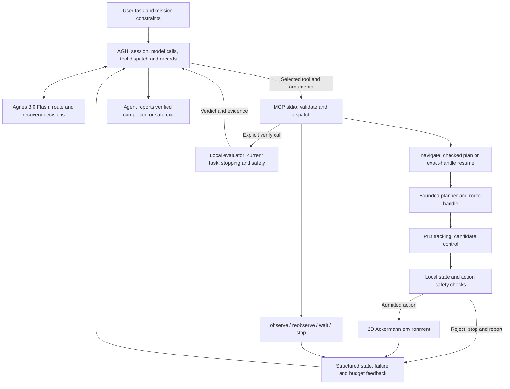

# EmbodiedGuard

### Autonomous inspection, feedback-driven recovery, and independently checked execution

**English** | [简体中文](README.zh-CN.md)

[Demo Video](https://www.bilibili.com/video/BV1WYpm6vErh/) · [Architecture](docs/ARCHITECTURE.en.md) · [Integration Standards](docs/INTEGRATION.md) · [Competition Release](https://github.com/HoseaZou/EmbodiedGuard/releases/tag/competition-v14) · [CI](https://github.com/HoseaZou/EmbodiedGuard/actions/workflows/verify.yml)

**2026 Jiangsu AI+ Science and Engineering Innovation Practice Hackathon (University Division)**
Undergraduate team · Entry **U308** · **停下吃花生** · Nanjing University of Aeronautics and Astronautics

> **Official competition version: V14.** Source comes from our final **r3 submission package**; r3 identifies the delivery revision. The fixed [`competition-v14`](https://github.com/HoseaZou/EmbodiedGuard/tree/competition-v14) tag preserves the original public release. The default branch includes subsequent documentation updates. All **78 original application Python files** and the r3 task prompt retain their submitted bytes. See [version identity](COMPETITION_VERSION.json) and [documentation history](docs/DOCUMENTATION-UPDATES.md).

## Project Overview

### Background

An inspection robot can follow a route yet fail its mission when observations become stale, an aisle is blocked, or execution stops unexpectedly. Continuing from invalid state is unsafe; stopping without interpreting the failure leaves the task unfinished.

EmbodiedGuard connects **Agnes Harness (AGH)**, **Agnes 3.0 Flash**, and local deterministic planning and control. The Agent chooses a permitted route and recovery action from actual tool feedback. The executor checks state and candidate actions before motion. A separate local `verify` tool establishes the current task outcome.

### Core Features and Contributions

| Capability | Implementation and value |
|---|---|
| Feedback-driven recovery | The Agent can reacquire observations, resume a valid route, request a new plan, wait, or explicitly terminate based on the failure. |
| Reused autonomous-driving execution | Bounded forward Ackermann planning, adapted PID tracking and state handling provide a lightweight execution base. |
| Explicit decision boundary | Six focused MCP tools expose task-level choices; `navigate` bundles checked execution on the chosen route without silently choosing recovery. |
| Independent safety checks | Observation validity, action bounds, braking prediction, footprint, obstacle, speed, boundary and budget checks remain local. |
| Traceable results | Route handles, idempotent operation IDs, tool journals, actual motion traces and final verification connect decisions to evidence. |
| Efficient feedback | Compact responses remove known repetitions while retaining current constraints, budgets, unknown or failed checks, and final verification details. |

The implementation supports **three-target synthetic inspection** and **single-goal navigation on known public maps**, using a lightweight **2D forward Ackermann kinematic simulator**. It requires no ROS, CARLA, GPU or newly trained model weights.

## Demo Video

**[Watch the competition demonstration on Bilibili](https://www.bilibili.com/video/BV1WYpm6vErh/)**

The video introduces the task, Agent/executor responsibilities, and recorded recovery and trajectory results:

```text
Observe → navigate → stale observation / safe stop
        → Agent chooses reobserve → Agent resumes the chosen route → verify
```

Follow [Quick Start](#quick-start) and [AGH Integration](#agh-integration) to reproduce the software environment. This video shows a recorded run; new model sessions may choose different actions.

## Architecture



| Layer | Responsibility | Source |
|---|---|---|
| AGH and Agnes | Sessions, explicit tool selection, route and recovery reasoning | External runtime; [frozen prompt](prompt-plus.frozen.txt) |
| MCP and execution transaction | Schemas, focused catalog, plan/resume choice, idempotent execution | [`mcp_server.py`](EmbodiedGuard-v14/embodiedguard/mcp_server.py), [`efficiency.py`](EmbodiedGuard-v14/embodiedguard/efficiency.py) |
| Planning and control | Geometry, route tracking, candidate controls | [`planning.py`](EmbodiedGuard-v14/embodiedguard/planning.py), [`global_planning.py`](EmbodiedGuard-v14/embodiedguard/global_planning.py), [`control.py`](EmbodiedGuard-v14/embodiedguard/control.py), [`legacy/`](EmbodiedGuard-v14/embodiedguard/legacy/) |
| State and safety | Freshness, frame validation, action and braking checks | [`state.py`](EmbodiedGuard-v14/embodiedguard/state.py), [`safety.py`](EmbodiedGuard-v14/embodiedguard/safety.py), [`action_contract.py`](EmbodiedGuard-v14/embodiedguard/action_contract.py) |
| Mission and evaluation | Progress, stopped inspection, budgets, current verdict and logs | [`execution.py`](EmbodiedGuard-v14/embodiedguard/execution.py), [`sim.py`](EmbodiedGuard-v14/embodiedguard/sim.py), [`public_maps.py`](EmbodiedGuard-v14/embodiedguard/public_maps.py), [`runtime_final.py`](EmbodiedGuard-v14/embodiedguard/runtime_final.py) |

`verify` is **local and deterministic**, independent of the model's answer. The Agent calls it after final arrival/inspection or explicit termination; the result returns through MCP to AGH and the Agent. Per-step safety checks run inside the executor, without a model call at each control step. See the [full feedback chain](docs/ARCHITECTURE.en.md).

## Integration Standards

- **Transport:** local stdio MCP, newline-delimited UTF-8 JSON-RPC 2.0. Initialize, send `notifications/initialized`, then use `tools/list` and `tools/call`. Stdout carries protocol messages; stderr carries diagnostics.
- **Tools:** `observe`, `navigate`, `reobserve`, `wait`, `stop`, `verify`. Required types, enums and bounds come from the server's `tools/list`; undeclared arguments are rejected.
- **Navigation:** choose the current target, a permitted route and `route_mode=plan/resume`. Use a new `operation_id` for new work. Exact retries return historical receipts; changed requests cannot reuse an ID.
- **State:** world-frame metres, radians and seconds; counterclockwise positive yaw. Freshness and identity metadata are explicit. Unknown, missing or stale observations never imply free space.
- **Results:** read `structuredContent`, MCP `isError`, task status, failure reason, current budgets and recovery metadata. Transport success does not imply mission success.
- **Execution:** public-map navigation permits at most two checked tracking windows, each up to 15 simulated seconds plus separate braking. Failures return immediately. The Agent cannot disable safety or overwrite supervisor-owned constraints.
- **Scope:** this release integrates through **MCP**. Real-device MHS adapters and hardware validation are separate future work.

[Full English integration specification](docs/INTEGRATION.md) · [中文集成规范](docs/INTEGRATION.zh-CN.md): tool arguments, sample calls, output fields, session isolation and acceptance checks.

## Quick Start

Use **Python 3.11+**. Public maps require NumPy; tests require pytest. Run from the repository root:

```sh
python -m venv .venv
# Windows PowerShell: .venv\Scripts\Activate.ps1
# Linux/macOS: source .venv/bin/activate
python -m pip install -e "./EmbodiedGuard-v14[public,test]"
python tools/verify_release.py
```

If PowerShell blocks activation, use `.venv/Scripts/python.exe` directly. The retained package version `0.1.0` is historical metadata; the competition identity is **V14**.

### Local Demo Without a Model Account

```sh
python -m embodiedguard.cli demo --scenario stale --policy fixed_recovery --segment-seconds 15 --output runtime_data/local-demo
```

Open `runtime_data/local-demo/replay.html`; inspect `summary.json`. This installation/execution demo uses a **fixed rule policy**. To exercise Agnes decisions, use AGH below.

## AGH Integration

1. Install and configure AGH from the [official repository](https://github.com/AgnesAI-Labs/agnes-harness), using your own model account. Competition sessions used `agnes-3.0-flash`.
2. Run the following in your installed Python environment and add the printed stdio server parameters to AGH's MCP configuration:

   ```sh
   python tools/print_mcp_config.py
   ```

3. Confirm the six tools are available and review AGH tool permissions. Use a fresh session and fresh mission process for each independent trial.
4. Send the original r3 [task prompt](prompt-plus.frozen.txt). Read the initial observation before navigating; public-map start positions come from the selected map scenario.
5. Read final `verify`. Keep simulator outputs separate from AGH's native conversation/tool trace; export the latter through AGH's official interface when needed.

The generated configuration uses this checked entry:

```sh
python EmbodiedGuard-v14/run_checked_final_mcp.py --mode public --map maze512-16-0 --line 142 --scale 0.5 --fault freeze_once --output runtime_data/agh-public
```

This stdio server waits for client input; it does not open a website. Outputs must remain under the repository root. See [integration details](docs/INTEGRATION.md) and the [Chinese AGH walkthrough](docs/AGH-MCP.md).

## Validation

| Evidence | Recorded result | Scope |
|---|---|---|
| Competition AGH sessions | **8 sessions: 6 completed feasible tasks, 2 supported safe exits** | Historical native Agent runs; safe exits counted separately |
| Recorded safety | **0 collisions, boundary violations or speed violations** in those sessions | Tested simulator scenarios |
| Open-source preparation | **268 tests and 87 subtests passed** | Windows / Python 3.12, 2026-10-21 |
| Published CI | Original public release passed on **Ubuntu and Windows** | [Recorded run](https://github.com/HoseaZou/EmbodiedGuard/actions/runs/39563319688); later commits have separate CI |
| Source preservation | **78 original application Python files byte-identical** | Compared with the final r3 archive |

Reproduce local checks:

```sh
python tools/verify_release.py
python -m pytest -q EmbodiedGuard-v14/tests
python tools/smoke_mcp.py
```

The smoke check performs **zero motion and zero model calls**. These checks add no competition Agent samples. Validation covers synthetic 2D kinematics and known maps; temperature fixtures are synthetic. Physical deployment requires sensor, adapter and chassis validation. No AutoVLA weights are loaded or trained. Details: [validation record](docs/VALIDATION.md), [release provenance](docs/COMPETITION-RELEASE.md).

## Repository Layout

```text
README.md / README.zh-CN.md   English default and Chinese overview
EmbodiedGuard-v14/            Competition implementation and original tests
sources/                     Required Moving AI maps and attribution
provenance/                  Submitted hashes and declared publication changes
docs/                        Architecture, integration, release and validation
tools/                       Integrity and local MCP configuration helpers
reports/                     Separately attributed historical test fixture only
```

Use `run_checked_final_mcp.py` as the supported entry. Older launch scripts and in-app READMEs document the original workspace.

## Team and License

- **邹鸿生 (team lead):** AGH integration, end-to-end execution, optimization and validation.
- **王雯婷:** implementation, adaptation, testing and presentation.

Team-owned code and publication documentation use the [MIT License](LICENSE). Moving AI data retains ODC-By v1.0 terms and attribution. AGH is installed separately under its own license. See [third-party notices](THIRD_PARTY_NOTICES.md).

Original submission archive SHA-256: `e20e22a2266a29f97d331fcc7955cbacfc5c299432cd7525ff72f867520b7eb7`. Preserve `competition-v14` and the existing release assets; future algorithm changes should use a separate branch or version.
