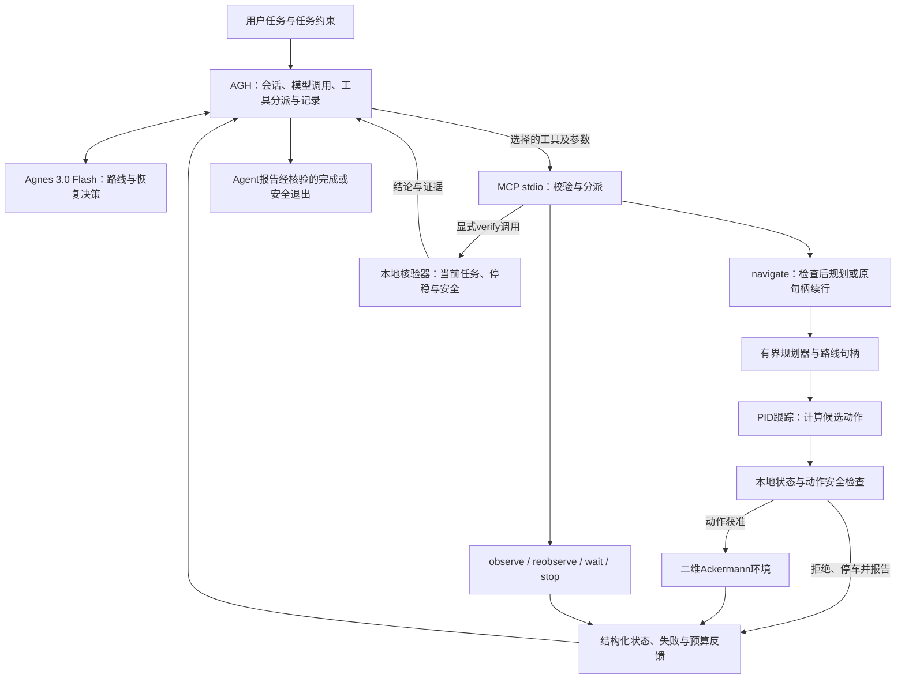

# EmbodiedGuard

### 无人巡检自主决策与安全恢复智能体

[English](README.md) | **简体中文**

[演示视频](https://www.bilibili.com/video/BV1WYpm6vErh/) · [技术架构](docs/ARCHITECTURE.md) · [集成规范](docs/INTEGRATION.zh-CN.md) · [参赛发布版](https://github.com/HoseaZou/EmbodiedGuard/releases/tag/competition-v14) · [自动检查](https://github.com/HoseaZou/EmbodiedGuard/actions/workflows/verify.yml)

**2026江苏省AI+科学与工程创新实践黑客松（高校组）**
本科生组 · 参赛编号 **U308** · **停下吃花生** · 南京航空航天大学

> **本仓库明确保留参赛版本V14。** 代码来自最终 **r3参赛交付包**；r3是交付材料修订号。固定标签 [`competition-v14`](https://github.com/HoseaZou/EmbodiedGuard/tree/competition-v14) 保留首次公开发布状态，默认分支在此基础上补充展示文档。原应用目录的 **78个Python文件**和r3提示词均保留提交字节。详见[版本身份](COMPETITION_VERSION.json)与[文档更新记录](docs/DOCUMENTATION-UPDATES.md)。

## 项目介绍（Project Overview）

### 项目背景

巡检机器人能够沿路线行驶，并不意味着出现故障后还能完成任务：观测过期、通道阻塞或执行中断，都需要系统判断下一步。依据失效状态继续行驶不安全，单纯停车又无法接续任务。

EmbodiedGuard连接 **Agnes Harness（AGH）**、**Agnes 3.0 Flash**和本地确定性规划控制。Agent根据工具反馈选择允许的路线与恢复动作，执行层在运动前检查状态和候选动作，最终由独立的本地 `verify` 工具核验当前任务结果。

### 核心功能与创新亮点

| 能力 | 实现与价值 |
|---|---|
| 根据反馈自主恢复 | Agent依据实际失败信息选择重观测、有效路线续行、新规划、等待或显式终止。 |
| 自动驾驶执行底座复用 | 有界前向Ackermann规划、适配的PID跟踪与状态处理构成轻量执行基础。 |
| 清晰的决策边界 | 六个focused MCP工具承载任务决策；`navigate`整合已选路线的检查执行，不暗中替Agent选择恢复策略。 |
| 独立安全检查 | 观测有效性、动作约束、制动预测、车体占位、障碍、速度、边界和预算由本地组件检查。 |
| 决策与结果可追溯 | 路线句柄、幂等操作ID、工具日志、实际运动轨迹与最终核验形成证据链。 |
| 精简执行反馈 | 去除已知重复解释，保留当前约束、预算、未知或失败检查及最终核验详情。 |

当前支持**三目标合成巡检**与**已知公开地图单目标到达任务**，采用轻量的**二维前向Ackermann运动学仿真**，无需ROS、CARLA、GPU或新训练模型权重。

## 视频介绍（Demo Video）

**[点击观看Bilibili参赛演示视频](https://www.bilibili.com/video/BV1WYpm6vErh/)**

视频展示巡检问题、Agent与执行层的分工，以及留存的故障恢复和轨迹结果：

```text
观测 → 导航 → 观测过期并安全停车
     → Agent选择重观测 → Agent选择原路线续行 → 最终verify
```

本机复现见[快速开始](#快速开始)与[AGH接入](#agh接入)。视频为已记录运行，新模型会话的决策以实际反馈为准。

## 架构介绍（Architecture）



| 层级 | 职责 | 代码位置 |
|---|---|---|
| AGH与Agnes | 会话管理、显式选工具、路线与恢复推理 | 外部运行时；[冻结提示词](prompt-plus.frozen.txt) |
| MCP与执行事务 | 参数Schema、六工具目录、plan/resume选择、幂等执行 | [`mcp_server.py`](EmbodiedGuard-v14/embodiedguard/mcp_server.py)、[`efficiency.py`](EmbodiedGuard-v14/embodiedguard/efficiency.py) |
| 规划与控制 | 几何规划、轨迹跟踪与候选动作 | [`planning.py`](EmbodiedGuard-v14/embodiedguard/planning.py)、[`global_planning.py`](EmbodiedGuard-v14/embodiedguard/global_planning.py)、[`control.py`](EmbodiedGuard-v14/embodiedguard/control.py)、[`legacy/`](EmbodiedGuard-v14/embodiedguard/legacy/) |
| 状态与安全 | 观测时效、帧检查、动作约束与制动检查 | [`state.py`](EmbodiedGuard-v14/embodiedguard/state.py)、[`safety.py`](EmbodiedGuard-v14/embodiedguard/safety.py)、[`action_contract.py`](EmbodiedGuard-v14/embodiedguard/action_contract.py) |
| 任务与核验 | 进度、停稳巡检、预算、当前判定和日志 | [`execution.py`](EmbodiedGuard-v14/embodiedguard/execution.py)、[`sim.py`](EmbodiedGuard-v14/embodiedguard/sim.py)、[`public_maps.py`](EmbodiedGuard-v14/embodiedguard/public_maps.py)、[`runtime_final.py`](EmbodiedGuard-v14/embodiedguard/runtime_final.py) |

`verify`是独立于模型表述的**本地确定性组件**。Agent在最终到达/巡检或显式终止后调用，结果经MCP返回AGH和Agent；逐步安全检查在执行层完成，无需每个控制步调用大模型。详见[完整反馈链路](docs/ARCHITECTURE.md)。

## 集成标准（Integration Standards）

- **传输协议：** 本地stdio MCP，UTF-8逐行JSON-RPC 2.0；先 `initialize`、`notifications/initialized`，再 `tools/list`、`tools/call`。stdout放协议消息，stderr放诊断。
- **工具规范：** `observe`、`navigate`、`reobserve`、`wait`、`stop`、`verify`；必填项、类型、枚举及范围以运行服务的 `tools/list` 为准，拒绝未声明参数。
- **导航契约：** 选择当前目标、允许路线和 `route_mode=plan/resume`。新执行使用新 `operation_id`；完全相同的重试返回历史收据，同一ID不能复用于不同请求。
- **状态坐标：** 世界坐标，米、弧度、秒，逆时针为正；显式提供时效和身份字段，未知、缺失或过期观测不当成空环境。
- **结果判读：** 读取 `structuredContent`、MCP `isError`、任务状态、失败原因、当前预算及恢复信息；传输成功不等于任务完成。
- **执行边界：** 公开地图一次导航最多两个经检查窗口，每窗最多跟踪15秒仿真时间，随后另行制动；失败立即返回。Agent不能关闭安全检查或改写管理端约束。
- **接入范围：** 本版通过 **MCP**接入AGH；真实设备MHS适配及硬件验证单独开展。

[中文完整规范](docs/INTEGRATION.zh-CN.md) · [English Integration Specification](docs/INTEGRATION.md)：工具参数、请求示例、返回字段、会话隔离与接入验收。

## 快速开始

使用 **Python 3.11+**；公开地图需要NumPy，测试需要pytest。以下命令在仓库根目录执行：

```sh
python -m venv .venv
# Windows PowerShell：.venv\Scripts\Activate.ps1
# Linux/macOS：source .venv/bin/activate
python -m pip install -e "./EmbodiedGuard-v14[public,test]"
python tools/verify_release.py
```

若PowerShell限制激活，直接使用 `.venv/Scripts/python.exe`。保留的软件包版本 `0.1.0` 是历史元数据，参赛身份以 **V14** 为准。

### 无需模型账号的本地体验

```sh
python -m embodiedguard.cli demo --scenario stale --policy fixed_recovery --segment-seconds 15 --output runtime_data/local-demo
```

打开 `runtime_data/local-demo/replay.html`，通过 `summary.json` 查看判定。此安装/执行演示使用**固定规则策略**；体验Agnes决策请按下节接入AGH。

## AGH接入

1. 从[官方仓库](https://github.com/AgnesAI-Labs/agnes-harness)安装配置AGH，使用自己的模型账号。参赛会话使用 `agnes-3.0-flash`。
2. 在安装好依赖的Python环境运行下列命令，将输出的stdio参数加入AGH的MCP配置：

   ```sh
   python tools/print_mcp_config.py
   ```

3. 确认六工具可用并核对AGH权限。独立试验使用新会话和新任务进程。
4. 发送原r3[任务提示词](prompt-plus.frozen.txt)，先观测再导航；公开地图初始位置来自所选地图场景。
5. 阅读最终 `verify`。仿真输出与AGH原生对话/工具轨迹分别留存，需要原生留证时通过AGH官方界面导出。

配置生成器使用以下已校验入口：

```sh
python EmbodiedGuard-v14/run_checked_final_mcp.py --mode public --map maze512-16-0 --line 142 --scale 0.5 --fault freeze_once --output runtime_data/agh-public
```

stdio服务等待客户端输入，不自行打开网页；输出必须位于仓库根目录内。详见[集成规范](docs/INTEGRATION.zh-CN.md)与[AGH操作说明](docs/AGH-MCP.md)。

## 验证结果

| 证据 | 已记录结果 | 口径 |
|---|---|---|
| 参赛AGH会话 | **8次：6次可行任务完成，2次有据安全退出** | 历史真实Agent运行；完成与安全退出分开统计 |
| 上述会话安全结果 | **碰撞、边界违规、超速违规均为0** | 对应已测仿真场景 |
| 公开整理回归 | **268项测试、87项子测试通过** | Windows / Python 3.12，2026-10-21 |
| 已发布CI | 首次公开发布在 **Ubuntu与Windows均通过** | [原始记录](https://github.com/HoseaZou/EmbodiedGuard/actions/runs/39563319688)；后续提交独立检查 |
| 原代码保留 | **78个原应用Python文件逐字节一致** | 对照最终r3包 |

本地复核：

```sh
python tools/verify_release.py
python -m pytest -q EmbodiedGuard-v14/tests
python tools/smoke_mcp.py
```

协议检查为**零运动、零模型调用**，不增加参赛Agent样本。当前验证覆盖合成二维运动学与已知地图，温度证据来自合成fixture；实际部署还需验证传感器、适配接口及底盘。本项目未加载或训练AutoVLA权重。详见[验证记录](docs/VALIDATION.md)与[参赛版本说明](docs/COMPETITION-RELEASE.md)。

## 目录结构

```text
README.md / README.zh-CN.md   默认英文首页与中文介绍
EmbodiedGuard-v14/            参赛代码及原测试
sources/                     必需的Moving AI地图及署名
provenance/                  提交哈希与公开整理差异
docs/                        架构、集成、版本及验证说明
tools/                       校验与本机MCP配置辅助工具
reports/                     单独注明来源的历史测试fixture
```

支持入口为 `run_checked_final_mcp.py`；旧启动脚本和应用内历史README用于记录原开发工作区。

## 团队与许可

- **邹鸿生（队长）：** AGH接入、全链路联调、优化及验证。
- **王雯婷：** 代码实现与适配、测试及展示材料。

团队自有代码与公开文档采用 [MIT License](LICENSE)。Moving AI数据保留ODC-By v1.0许可及署名；AGH独立安装并遵循自身许可。详见[第三方来源与授权](THIRD_PARTY_NOTICES.md)。

原r3包SHA-256：`e20e22a2266a29f97d331fcc7955cbacfc5c299432cd7525ff72f867520b7eb7`。保留 `competition-v14` 标签与已有Release附件；后续算法改进使用其他分支或版本。
