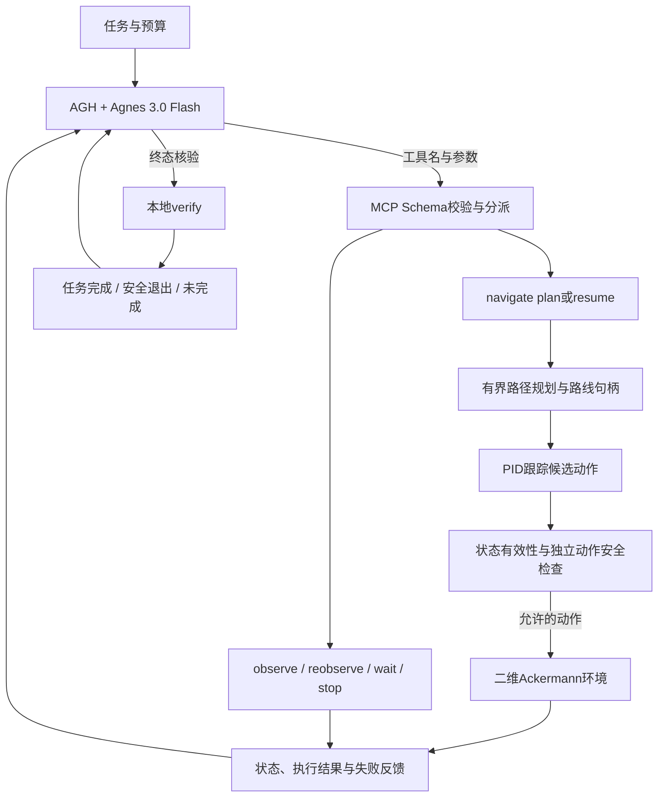

# 参赛版本的组件与执行链路

[English](ARCHITECTURE.en.md) | **简体中文** · [项目首页](../README.zh-CN.md) · [集成规范](INTEGRATION.zh-CN.md)

Agnes根据工具说明和结构化反馈显式选择工具，MCP负责传输与分派，本地规划器计算路线，控制器计算动作。

## navigate的边界

`plan`生成新路线，`resume`要求匹配当前有效路线句柄，不重新生成几何。公开地图一次导航最多组织两个原始执行窗口，合成focused巡检一次一个窗口；每窗跟踪最多15秒，随后另行制动，15秒不是整次工具调用耗时上限。仅正常部分完成的公开地图窗口可继续第二窗，失败立即返回，不自行替Agent选替代路线、刷新传感器、切换目标或调用最终verify。到达并停稳后才进行内部巡检。

## 安全与观测

观测有episode、frame、观测/接收时间和有效标识。未知或过期状态不当作空场景。动作须有限且满足输入边界；执行层预测当前动作及制动过程，检查车体占位、障碍、速度和边界。公开格网还包含原始占位审核。

预算与恢复账本限制任务执行。恢复额度耗尽会拒绝恢复并停车，退出仍须显式`stop(terminate=true)`；任务时间等预算耗尽可自动终止。模型没有关闭这些检查的工具。

## verify

由Agent依据最后目标实际到达/巡检反馈或终止反馈，及时显式调用，再由verify判定是否真正完成；不预先假定成功。确定性检查目标、到达、停稳、安全与预算，结果经MCP返回AGH，再供Agnes形成最终答复。它是独立于模型措辞的本地判定；入口也处理预算耗尽，因此不能说整个函数完全无副作用。历史完成收据不覆盖当前核验。每个控制步的安全检查在执行器内部进行，不需要每步调用大模型或显式verify。

## 参赛真实恢复案例

实际业务工具序列为`observe → navigate(plan, global) → reobserve → navigate(resume, global) → verify`。预设冻结导致执行返回过期停车，模型读取反馈、选择重观测，再复用原路线续行并完成核验。此公开目录保留实现和r3原提示；原带账号上下文会话ZIP不直接公开。
